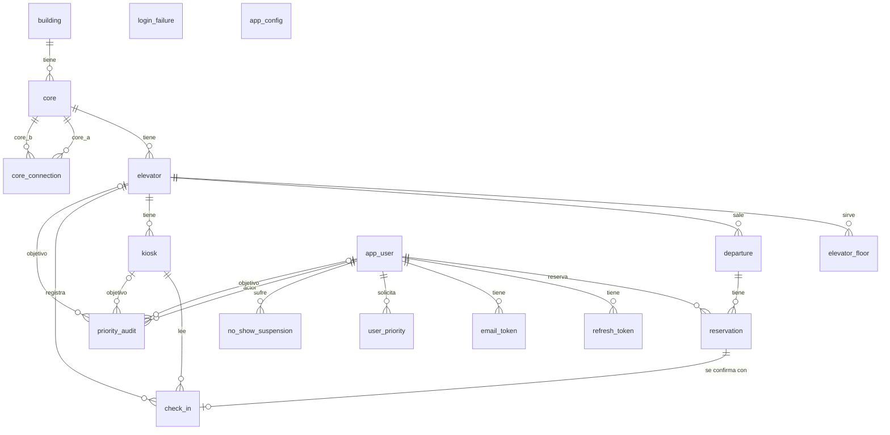
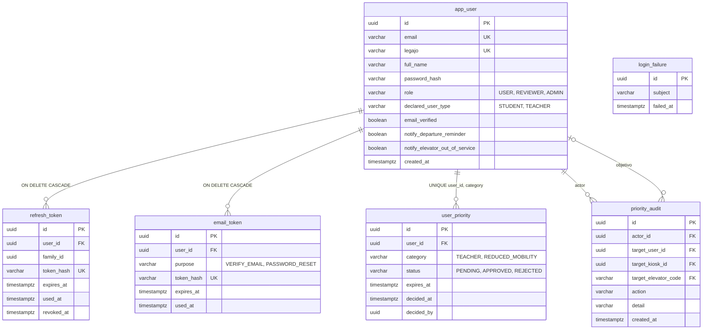
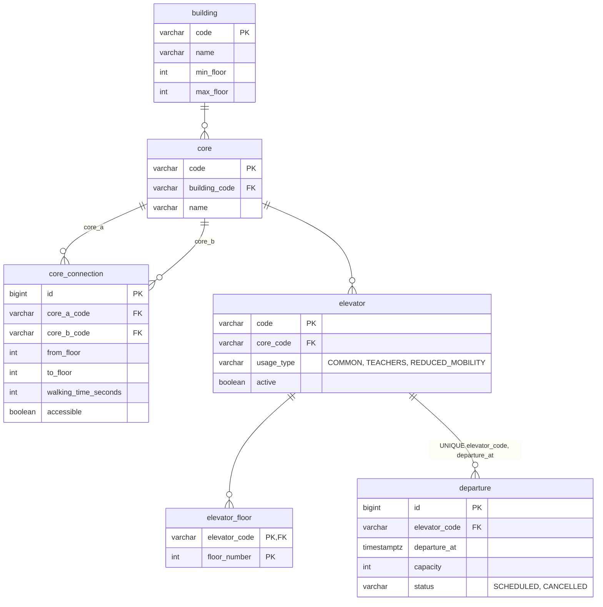
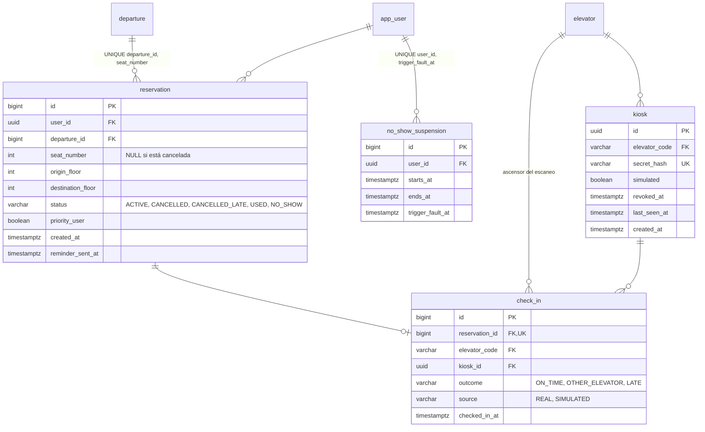
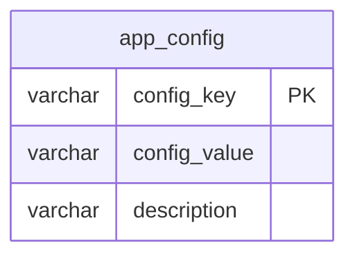

# Diagrama entidad-relación (DER)

Esquema de la base de datos tras las migraciones Flyway `V1` a `V22`. **Es documentación derivada: la fuente de verdad son las migraciones** (`backend/src/main/resources/db/migration/`) y las entidades JPA (`**/model`). Se verificó consultando `INFORMATION_SCHEMA` de una base H2 (perfil `dev`) recién migrada. Decisión de migraciones: [ADR 0004](../adr/0004-migraciones-de-base-de-datos.md).

Son 17 tablas de negocio más `flyway_schema_history` (la maneja Flyway). Los ids de usuarios, tokens, kioscos y auditoría son `uuid`; los de reservas, salidas, check-ins, suspensiones y conexiones son `bigint`; ascensores, núcleos y edificios usan un código de texto como clave.

## Visión general

`login_failure` (intentos fallidos por sujeto, para el límite de intentos) y `app_config` (parámetros de negocio) no tienen claves foráneas.

## Usuarios y sesión

`user_priority.decided_by` es un `uuid` sin clave foránea (quién decidió). `priority_audit` registra los cambios de rol, de prioridad y de kioscos o ascensores: exactamente uno de los tres objetivos (usuario, kiosco, ascensor) está completo.

## Ascensores y salidas

## Reservas, check-in y suspensión

## Configuración, KPIs y notificaciones

No hay tablas propias para los turnos de cursada, la congestión ni las notificaciones: se resuelven con una tabla de parámetros y columnas ya vistas.

- **Turnos de cursada (mañana, tarde, noche)** y **umbrales de congestión**: claves `morning_shift_*`, `afternoon_shift_*`, `night_shift_*`, `congestion_medium_from` y `congestion_high_from` (V19, V22). Los KPIs se calculan en consulta sobre `departure`, `reservation` y `check_in`; no se guardan.
- **Notificaciones por email**: preferencias en `app_user.notify_*` y marca de idempotencia en `reservation.reminder_sent_at` (V20); el adelanto del recordatorio es `departure_reminder_before` en `app_config`.
- El resto de `app_config` son las reglas ajustables sin redeploy: cupo (`turn_capacity`, `priority_seats_per_departure`), ventanas de reserva, check-in y cancelación, no-show y suspensión, pisos bajos, horario de operación y `semester_end_dates` ([ADR 0017](../adr/0017-donde-viven-los-parametros.md)).

## Constraints que sostienen reglas de negocio

| Constraint | Regla que protege | Dónde se explica |
| --- | --- | --- |
| `UNIQUE (reservation.departure_id, seat_number)` | Cupo atómico: no hay dos personas en el mismo lugar de una salida | [ADR 0007](../adr/0007-modelo-de-turnos-y-reservas.md), [ADR 0010](../adr/0010-integridad-de-reservas-tiempo-y-configuracion.md), [turnos](../reglas/turnos.md) |
| `CHECK (seat_number > 0)` y `departure.capacity > 0` | Lugares numerados desde 1 y salidas con capacidad | [turnos](../reglas/turnos.md) |
| `CHECK ((status IN ('CANCELLED','CANCELLED_LATE')) = (seat_number IS NULL))` | Una reserva cancelada libera su lugar; una vigente siempre tiene uno | [ADR 0010](../adr/0010-integridad-de-reservas-tiempo-y-configuracion.md) |
| `CHECK` de `reservation.status` | Estados válidos: `ACTIVE`, `CANCELLED`, `CANCELLED_LATE`, `USED`, `NO_SHOW` | [turnos](../reglas/turnos.md) |
| `UNIQUE (departure.elevator_code, departure_at)` | Una sola salida por ascensor y horario (la franja es una salida de ~2 min) | [ADR 0007](../adr/0007-modelo-de-turnos-y-reservas.md) |
| `CHECK` de `departure.status` | `SCHEDULED` o `CANCELLED` (ascensor fuera de servicio) | [turnos](../reglas/turnos.md) |
| `UNIQUE (check_in.reservation_id)` | Un solo check-in por reserva: un QR no se canjea dos veces | [ADR 0008](../adr/0008-check-in-con-qr-rotativo.md), [check-in](../reglas/check-in-qr.md) |
| `CHECK` de `check_in.outcome` y `source` | Resultado (`ON_TIME`, `OTHER_ELEVATOR`, `LATE`) y origen (`REAL`, `SIMULATED`) | [check-in](../reglas/check-in-qr.md) |
| `UNIQUE (kiosk.secret_hash)` | La credencial del kiosco se guarda hasheada y no se repite | [ADR 0020](../adr/0020-autenticacion-de-kioscos-por-credencial-de-dispositivo.md) |
| `UNIQUE (no_show_suspension.user_id, trigger_fault_at)` y `CHECK (ends_at > starts_at)` | Una falta dispara a lo sumo una suspensión | [check-in](../reglas/check-in-qr.md) |
| `UNIQUE (user_priority.user_id, category)` | Una solicitud por categoría y persona | [usuarios y prioridad](../reglas/usuarios-y-prioridad.md), [ADR 0009](../adr/0009-autenticacion-y-prioridad.md) |
| `CHECK` de `user_priority.category` y `status` | Categorías `TEACHER` y `REDUCED_MOBILITY`; estados `PENDING`, `APPROVED`, `REJECTED` | [ADR 0009](../adr/0009-autenticacion-y-prioridad.md), [ADR 0024](../adr/0024-movilidad-reducida-la-marca-viene-de-ofalu.md) |
| `CHECK` de `priority_audit`: exactamente un objetivo | Cada acción auditada apunta a un usuario, un kiosco o un ascensor | [ADR 0009](../adr/0009-autenticacion-y-prioridad.md) |
| `UNIQUE (app_user.email)`, `UNIQUE (legajo)`, `CHECK (email = LOWER(email))` | Una cuenta por email institucional y por legajo, sin variantes de mayúsculas | [ADR 0009](../adr/0009-autenticacion-y-prioridad.md) |
| `CHECK` de `app_user.role` y `declared_user_type` | Roles `USER`, `REVIEWER`, `ADMIN`; el tipo declarado no da prioridad | [ADR 0009](../adr/0009-autenticacion-y-prioridad.md) |
| `UNIQUE (refresh_token.token_hash)`, `family_id`, FK `ON DELETE CASCADE` | Rotación del refresh con detección de reuso por familia | [ADR 0019](../adr/0019-refresh-token-en-cookie-httponly.md) |
| `UNIQUE (email_token.token_hash)` y `CHECK` de `purpose` | Tokens de verificación y de recuperación, de un solo uso | [ADR 0009](../adr/0009-autenticacion-y-prioridad.md) |
| `CHECK` de `elevator.usage_type` | Ascensor `COMMON`, `TEACHERS` o `REDUCED_MOBILITY` | [asignación](../reglas/asignacion.md) |
| `CHECK (core_a_code <> core_b_code)`, `from_floor <= to_floor`, `walking_time_seconds > 0`; `building.min_floor <= max_floor` | Conexiones y rangos de pisos coherentes | [asignación](../reglas/asignacion.md) |

Todas son compatibles con H2 (`MODE=PostgreSQL`) y con Postgres. Hay además índices no únicos de apoyo (por ejemplo `ix_reservation_user`, `ix_login_failure_subject`).

## Cómo mantenerlo

- Al agregar una migración que cambie tablas, columnas, claves o constraints, **actualizá este DER en el mismo PR** (hay una casilla en la sección "Impacto" de la [plantilla del PR](../../.github/PULL_REQUEST_TEMPLATE.md)).
- Si las migraciones y este archivo discrepan, mandan las migraciones: corregí el DER.
- Para verificarlo contra una base real, levantá el backend en dev y consultá `INFORMATION_SCHEMA` en `/h2-console` (`http://localhost:8080/h2-console`, URL `jdbc:h2:mem:smartelevate`, usuario `sa`), o corré los tests de Flyway ([backend](../../backend/README.md#migraciones-de-la-base-flyway)).
